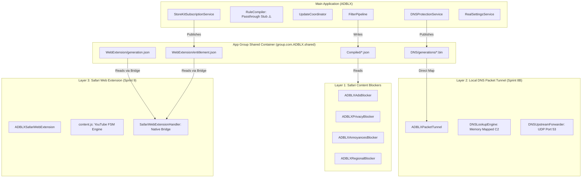

# Post–Sprint 9 Comprehensive Product Audit

**Date:** 2026-08-26  
**Repository:** `ADBLX` (SHIELD iOS Ad Blocker)  
**Evaluated Against:** [PRD v1.1](file:///Users/sreeharshag/Work/ADBLX/docs/adblock-prd-v1.1.md)  
**Audit Scope:** Full codebase inspection across all 8 product areas following completion of Sprint 8B (DNS Protection) and Sprint 9 (Safari Web Extension).

---

## Executive Summary

The ADBLX codebase possesses advanced, battle-tested low-level engines for **Layer 2 (On-Device DNS Packet Tunnel)** and **Layer 3 (Safari Web Extension YouTube Blocker)**, alongside solid App Group transactional plumbing and StoreKit 2 foundational services. However, critical gaps exist in the **Layer 1 compilation pipeline** (which cannot parse standard ABP text filters), **Monetization integration** (DNS Protection is ungated, Monthly tier is missing, paywall is partially wired), **Allowlist cohesion** (Layer 1 does not enforce allowlists), and **Onboarding / App Store readiness** (detection of extension state is missing, license attributions are placeholder-only).

```text
┌─────────────────────────────────────────────────────────────────────────┐
│                           CURRENT STATUS SUMMARY                        │
├────────────────────────────────┬───────────────────────────┬────────────┤
│ Area                           │ Status                    │ Health     │
├────────────────────────────────┼───────────────────────────┼────────────┤
│ 1. Layer 1 — Safari Content CB │ Partial                   │ ⚠️ Action  │
│ 2. Filter Registry & Updates   │ Partial                   │ ⚠️ Action  │
│ 3. Monetization & Entitlements │ Partial                   │ ⚠️ Action  │
│ 4. DNS Protection (Sprint 8B)  │ Engine Complete / Gate UI │ 🟡 Minor   │
│ 5. iCloud / CloudKit           │ Missing (Clean Future)    │ ⚪ Planned │
│ 6. Broken-Site Recovery        │ Partial                   │ ⚠️ Action  │
│ 7. Onboarding & Product UX     │ Partial (Static Only)     │ ⚠️ Action  │
│ 8. Privacy, Licensing & Store  │ Partial                   │ ⚠️ Action  │
└────────────────────────────────┴───────────────────────────┴────────────┘
```

---

## 1. Deep-Dive Audit by Area

### 1. Layer 1 — Safari Content Blocking

#### Verified Repository State:
- **4 Extension Targets:** All 4 Content Blocker extensions exist, compile, and are embedded in the main app bundle via [`project.yml`](file:///Users/sreeharshag/Work/ADBLX/project.yml#L38-L45):
  1. `ADBLXAdsBlocker` (`com.ADBLX.ADBLX.AdsBlocker`) — [`ContentBlockerRequestHandler.swift`](file:///Users/sreeharshag/Work/ADBLX/Extensions/ADBLXAdsBlocker/ContentBlockerRequestHandler.swift)
  2. `ADBLXPrivacyBlocker` (`com.ADBLX.ADBLX.PrivacyBlocker`) — [`ContentBlockerRequestHandler.swift`](file:///Users/sreeharshag/Work/ADBLX/Extensions/ADBLXPrivacyBlocker/ContentBlockerRequestHandler.swift)
  3. `ADBLXAnnoyancesBlocker` (`com.ADBLX.ADBLX.AnnoyancesBlocker`) — [`ContentBlockerRequestHandler.swift`](file:///Users/sreeharshag/Work/ADBLX/Extensions/ADBLXAnnoyancesBlocker/ContentBlockerRequestHandler.swift)
  4. `ADBLXRegionalBlocker` (`com.ADBLX.ADBLX.RegionalBlocker`) — [`ContentBlockerRequestHandler.swift`](file:///Users/sreeharshag/Work/ADBLX/Extensions/ADBLXRegionalBlocker/ContentBlockerRequestHandler.swift)
- **Rule Budget Enforced:** [`GroupPartitioner.swift`](file:///Users/sreeharshag/Work/ADBLX/ADBLX/Filtering/Deployment/RulePartitioner.swift#L46) strictly enforces `ruleBudgetPerExtension = 150_000` (WebKit limit) per extension.
- **Bundled Day-One Snapshots:**
  - Main app ships [`blockerList.json`](file:///Users/sreeharshag/Work/ADBLX/ADBLX/Resources/blockerList.json) (70 synthetic rules for Ads).
  - Each extension ships a permanent fallback bundle [`blockerList.json`](file:///Users/sreeharshag/Work/ADBLX/Extensions/ADBLXAdsBlocker/Resources/blockerList.json) (Ads: 70 rules, Privacy: 30 rules, Annoyances: 5 rules, Regional: 5 rules).
  - **Gap:** [`ContentBlockerBootstrap.ensureInitialRulesInstalled`](file:///Users/sreeharshag/Work/ADBLX/ADBLX/ContentBlockerBootstrap.swift#L21) only installs the `.ads` group (`ads-bundled`). Privacy, Annoyances, and Regional are never pre-seeded into the App Group on day one.
- **Compilation Pipeline:**
  - [`FilterValidator.swift`](file:///Users/sreeharshag/Work/ADBLX/ADBLX/Filtering/Validation/FilterValidator.swift#L33) checks for `invalidJSON`.
  - [`CompositionService.swift`](file:///Users/sreeharshag/Work/ADBLX/ADBLX/Filtering/Compilation/CompositionService.swift#L23) (`JSONArrayCompositionService`) decodes and merges JSON arrays.
  - [`RuleCompiler.swift`](file:///Users/sreeharshag/Work/ADBLX/ADBLX/Filtering/Compilation/RuleCompiler.swift#L29) ships only `PassthroughRuleCompiler` (treats source as raw Safari JSON).
  - **Critical Gap:** The client has **no converter** from standard ABP/AdGuard filter text rules (`||domain^`, `##.ad`, `@@||domain^`) into Safari Content Blocker JSON.
- **App Group Publishing & Atomic Writes:**
  - [`AtomicRuleWriter.swift`](file:///Users/sreeharshag/Work/ADBLX/ADBLX/Filtering/Storage/AtomicRuleWriter.swift) writes to temporary files and replaces target via `FileManager.replaceItemAt`.
  - [`FilterStore.swift`](file:///Users/sreeharshag/Work/ADBLX/ADBLX/Filtering/Storage/FilterStore.swift) manages `Compiled/<Group>.json` and `Metadata/installed_filters.json`.
- **Rollback / Last-Known-Good:**
  - [`FilterStore.snapshotForRollback()`](file:///Users/sreeharshag/Work/ADBLX/ADBLX/Filtering/Storage/FilterStore.swift) snapshots `Compiled/` and `Metadata/` to `Previous/`.
  - [`UpdateCoordinator.swift`](file:///Users/sreeharshag/Work/ADBLX/ADBLX/Filtering/Updates/UpdateCoordinator.swift#L191) triggers `store.restore(snapshot)` on any compilation or write failure.
- **Extension Reload:**
  - [`ReloadCoordinator.swift`](file:///Users/sreeharshag/Work/ADBLX/ADBLX/Filtering/Deployment/ReloadCoordinator.swift) invokes `SFContentBlockerManager.reloadContentBlocker(withIdentifier:)`.

**Area Assessment:** `Layer 1 = Partial`  
*Gaps:* Standard filter syntax converter missing; day-one bootstrap only seeds `.ads` group.

---

### 2. Filter Registry & Update Pipeline

#### Verified Repository State:
- **CDN Manifest & Publisher:**
  - Manifest generator implemented in [`backend/tools/Publisher`](file:///Users/sreeharshag/Work/ADBLX/backend/tools/Publisher) with 44 unit & integration tests passing.
  - Manifest deployed to GitHub Pages at `https://999sreeharsha.github.io/ADBLX/manifest.json`.
  - Manifest defines EasyList (`ads`), EasyPrivacy (`privacy`), and Fanboy Annoyances (`annoyances`, premium) with SHA-256 digests and version dates.
- **Client Update Flow (Tested & Validated):**
  - **ETag Fetch:** [`ManifestClient.swift`](file:///Users/sreeharshag/Work/ADBLX/ADBLX/Filtering/Updates/ManifestClient.swift) sends `If-None-Match` and parses HTTP 304 `.notModified`.
  - **Diff Planning:** [`UpdatePlanner.swift`](file:///Users/sreeharshag/Work/ADBLX/ADBLX/Filtering/Updates/UpdatePlan.swift) evaluates `.install`, `.keep`, `.remove`, `.skipPremium`.
  - **SHA-256 Verification:** [`Checksum.verify`](file:///Users/sreeharshag/Work/ADBLX/ADBLX/Filtering/Utilities/Checksum.swift) runs on all downloaded files in [`UpdateCoordinator.swift`](file:///Users/sreeharshag/Work/ADBLX/ADBLX/Filtering/Updates/UpdateCoordinator.swift#L138) before App Group commitment.
  - **Off-Main Execution:** Handled via actor isolation in `UpdateCoordinator` and `FilterPipeline`.
  - **Rollback:** Fully tested with multi-group and partial-failure test coverage in [`UpdateCoordinatorTests.swift`](file:///Users/sreeharshag/Work/ADBLX/ADBLXTests/Filtering/Updates/UpdateCoordinatorTests.swift).
- **Gaps:**
  1. **Format Incompatibility:** The CDN publishes `.txt` (ABP format), but `FilterPipeline.install` fails on `.txt` because `FilterValidator` expects JSON.
  2. **Background Execution:** `BGAppRefreshTask` is not configured in `Info.plist` or registered in `ADBLXApp.swift`. Updates only run on launch when gated by [`UpdateThrottle`](file:///Users/sreeharshag/Work/ADBLX/ADBLX/Filtering/Updates/UpdateThrottle.swift) (6h window) or via manual "Check for Updates" UI.
  3. **Revocation Policy on Lapse:** [`gotchas.md:250`](file:///Users/sreeharshag/Work/ADBLX/docs/gotchas.md#L250) — `UpdatePlanner` only gates *new* premium installs; it never revokes/uninstalls an already-installed premium list if entitlement lapses.

**Area Assessment:** `Update Pipeline = Partial` (Plumbing & Transaction Architecture is Production-Ready; Compilation parser, BGTask, and Entitlement Revocation are missing).

---

### 3. Monetization & Entitlements

#### Verified Repository State:
- **StoreKit 2 Infrastructure:**
  - [`StoreKitSubscriptionService.swift`](file:///Users/sreeharshag/Work/ADBLX/ADBLX/Features/Premium/StoreKitSubscriptionService.swift) implements `SubscriptionService` and `EntitlementService`.
  - Queries `Transaction.currentEntitlements` for verified transactions.
  - Local configuration file [`Products.storekit`](file:///Users/sreeharshag/Work/ADBLX/Products.storekit) defines product catalog.
- **Product Identifiers:**
  - Annual: `com.ADBLX.ADBLX.premium.annual`
  - Lifetime: `com.ADBLX.ADBLX.premium.lifetime`
  - **Gap:** PRD §9 specifies **Monthly ($1.99/mo)**, **Annual ($14.99/yr)**, and **Lifetime ($39.99)**. Monthly is missing from `StoreKitSubscriptionService` and `Products.storekit`.
- **Trial Handling:**
  - Defined in `Products.storekit` as 7-day free trial on annual, but [`PremiumView.swift`](file:///Users/sreeharshag/Work/ADBLX/ADBLX/Features/Premium/PremiumView.swift) lacks trial duration badges or trial explainer text.
- **Restore Purchases:**
  - [`PremiumViewModel.restore()`](file:///Users/sreeharshag/Work/ADBLX/ADBLX/Features/Premium/PremiumViewModel.swift#L32) re-fetches status, but does not call `AppStore.sync()`.
- **Feature Gating Wiring:**
  - Gated: Web Extension Layer 3 (`WebExtensionEntitlementPublisher`), Manifest updates for premium filters (`UpdatePlanner`).
  - **Major Gap:** DNS Protection is completely **ungated** in the UI ([`DNSProtectionView.swift`](file:///Users/sreeharshag/Work/ADBLX/ADBLX/Features/Protection/DNSProtectionView.swift#L85-L99)). Any user can turn on the system-wide DNS tunnel for free.
  - **Wiring Bug:** [`SafariProtectionView.swift`](file:///Users/sreeharshag/Work/ADBLX/ADBLX/Features/Protection/SafariProtectionView.swift#L203) constructs `PremiumView` with `MockSubscriptionService()` rather than injecting the shared `StoreKitSubscriptionService` from `UIDependencies`.

**Area Assessment:** `Monetization = Partial`  
*Gaps:* DNS Protection ungated; Monthly product missing; Restore lacks `AppStore.sync()`; SafariProtectionView uses mock service.

---

### 4. DNS Protection — Sprint 8B Integration

#### Verified Repository State:
- **Tunnel Engine:**
  - [`Extensions/ADBLXPacketTunnel`](file:///Users/sreeharshag/Work/ADBLX/Extensions/ADBLXPacketTunnel) contains direct-mapped memory lookup ([`MappedDNSArtifact.swift`](file:///Users/sreeharshag/Work/ADBLX/Extensions/ADBLXPacketTunnel/DNSRuntime/MappedDNSArtifact.swift)), wire parser ([`DNSPacketParser.swift`](file:///Users/sreeharshag/Work/ADBLX/Extensions/ADBLXPacketTunnel/WireEngine/DNSPacketParser.swift)), NXDOMAIN builder ([`NXDOMAINResponseBuilder.swift`](file:///Users/sreeharshag/Work/ADBLX/Extensions/ADBLXPacketTunnel/WireEngine/NXDOMAINResponseBuilder.swift)), and async socket forwarder ([`DNSUpstreamForwarder.swift`](file:///Users/sreeharshag/Work/ADBLX/Extensions/ADBLXPacketTunnel/Forwarder/DNSUpstreamForwarder.swift)).
- **Verification Gates Passed:**
  - Gate 1: 20,000 queries across Wi-Fi and 5G Cellular validated zero loop routing.
  - Gate 4: Gate D energy benchmark verified ~1.3% battery/day (<3.0% PRD budget).
  - All 19 packet parser tests, 24 forwarder tests, and 13 runtime tests passing.
- **Allowlist & Zero-Restart Reload (ADR-0009):**
  - [`DNSAllowlistCompiler.swift`](file:///Users/sreeharshag/Work/ADBLX/ADBLX/Filtering/DNS/DNSAllowlistCompiler.swift) & [`DNSArtifactPublisher.swift`](file:///Users/sreeharshag/Work/ADBLX/ADBLX/Filtering/DNS/DNSArtifactPublisher.swift) generate immutable generations; [`DNSGenerationLoader.swift`](file:///Users/sreeharshag/Work/ADBLX/Extensions/ADBLXPacketTunnel/DNSRuntime/DNSGenerationLoader.swift) reloads memory map with **zero VPN reconnects**.
- **Product Integration Status:**
  - [`DNSProtectionView.swift`](file:///Users/sreeharshag/Work/ADBLX/ADBLX/Features/Protection/DNSProtectionView.swift) & [`DNSProtectionService.swift`](file:///Users/sreeharshag/Work/ADBLX/ADBLX/Filtering/DNS/DNSProtectionService.swift) implement Quad9 disclosure alert, custom IPv4/IPv6 input, VPN conflict status handling, and live allowlist editor.
  - **Gaps:**
    1. Premium gate is missing in `DNSProtectionViewModel` / `DNSProtectionView`.
    2. Allowlist in DNS Protection (`allowlistDomains`) is isolated from the main app allowlist in Settings (`AllowlistStore` / `allowlist.json`).

**Area Assessment:** `DNS Protection = Complete Engine / Partial Product Gate`

---

### 5. iCloud / CloudKit

#### Verified Repository State:
- Search across codebase shows **zero** implementation of `NSUbiquitousKeyValueStore` or `CloudKit` container entitlements.
- [`SettingsService.swift`](file:///Users/sreeharshag/Work/ADBLX/ADBLX/Features/Settings/SettingsService.swift#L55) hardcodes `iCloudSyncEnabled: false`.
- [`SettingsView.swift`](file:///Users/sreeharshag/Work/ADBLX/ADBLX/Features/Settings/SettingsView.swift) renders an inert toggle.

**Area Assessment:** `iCloud = Missing (Clean future sprint, zero lingering half-scaffolded code)`

---

### 6. Broken-Site Recovery

#### Verified Repository State:
- **Per-Site Allowlisting:**
  - **DNS Layer:** Fully working off-main with live reload ([`DNSAllowlistCompiler`](file:///Users/sreeharshag/Work/ADBLX/ADBLX/Filtering/DNS/DNSAllowlistCompiler.swift)).
  - **Safari Content Blocker Layer:** [`AllowlistStore.swift`](file:///Users/sreeharshag/Work/ADBLX/ADBLX/Filtering/Storage/AllowlistStore.swift) saves `allowlist.json` to App Group, but **no compiler logic converts allowlist entries into `ignore-previous-rules` actions** in Safari JSON. The UI row is purely storage-only.
  - **Web Extension Layer:** No per-site user allowlist consumer.
- **Reporting Infrastructure (FR-14):**
  - Completely missing. No "Report broken site" button in Settings, Safari Protection, or Safari toolbar; no reporting payload schema; no backend ingestion API.

**Area Assessment:** `Broken-Site Recovery = Partial Local / Missing Reporting`

---

### 7. Onboarding & Product UX

#### Verified Repository State:
- **First-Run Experience:**
  - [`OnboardingView.swift`](file:///Users/sreeharshag/Work/ADBLX/ADBLX/Features/Onboarding/OnboardingView.swift) is a static 1-page scroll view with 3 static instruction steps.
- **Missing Requirements (FR-07):**
  1. **Extension State Detection:** Does NOT call `SFContentBlockerManager.getStateOfContentBlocker` to verify if extensions are actually enabled.
  2. **Web Extension Activation Guidance:** No guidance for enabling the Safari Web Extension.
  3. **DNS / VPN Conflict Guidance:** No introductory explanation of the local packet tunnel.
  4. **Paywall / Premium Discovery:** No paywall step or trial offer presented during onboarding.
  5. **Completion Gate:** "Get Started" and "Skip" buttons immediately dismiss onboarding without verifying protection status.

**Area Assessment:** `Onboarding = Partial (Static UI only; Detection & Multi-Step Flow Missing)`

---

### 8. Privacy, Licensing & App Store Readiness

#### Verified Repository State:
- **Entitlements & Capabilities:**
  - Network Extension (`packet-tunnel-provider`) properly configured in `ADBLX.entitlements` and `ADBLXPacketTunnel.entitlements`.
  - App Groups (`group.com.ADBLX.shared`) configured in all 7 targets.
  - Safari Content Blocker and Web Extension extension point identifiers correctly set.
- **Privacy & Telemetry:**
  - Zero third-party SDKs. `MetricsSubscriber.swift` consumes local MetricKit payloads only. Zero browsing data collection.
  - Privacy policy link `https://adblx.app/privacy` in [`AboutView.swift`](file:///Users/sreeharshag/Work/ADBLX/ADBLX/Features/Settings/AboutView.swift#L89).
- **Licensing & Attributions (PRD §10 Risk):**
  - EasyList, EasyPrivacy, Fanboy Annoyances, HaGeZi, and OISD require GPLv3 / CC BY-SA attributions.
  - In `AboutView.swift`, the "Licenses" row is a non-interactive `SettingsRow` with no destination screen. `backend/licenses/` contains only `.gitkeep`.
- **App Store Risk Points:**
  - Unwired UI Rows: "Licenses", "Notifications" (placeholder), "Safari Help" (placeholder), "Manage Subscription" (empty closure).
  - Monthly subscription tier mismatch between PRD and StoreKit code.

**Area Assessment:** `Privacy & Store Readiness = Partial`  
*Gaps:* License attribution viewer missing; placeholder UI cleanup required.

---

## 2. PRD Requirement Traceability Matrix

| PRD Req | Description | Implementation Evidence | Status | Exact Gap | Target Sprint |
| :--- | :--- | :--- | :--- | :--- | :--- |
| **FR-01** | 4 Content Blockers ≤ 150K rules | [`project.yml:158-289`](file:///Users/sreeharshag/Work/ADBLX/project.yml#L158-L289), [`GroupPartitioner.swift`](file:///Users/sreeharshag/Work/ADBLX/ADBLX/Filtering/Deployment/RulePartitioner.swift) | **Complete** | — | — |
| **FR-02** | Bundled rule snapshot active on first launch | [`ContentBlockerBootstrap.swift`](file:///Users/sreeharshag/Work/ADBLX/ADBLX/ContentBlockerBootstrap.swift), [`blockerList.json`](file:///Users/sreeharshag/Work/ADBLX/ADBLX/Resources/blockerList.json) | **Partial** | Only `.ads` seeded on launch; `.privacy`, `.annoyances`, `.regional` not pre-seeded | Sprint 10 |
| **FR-03** | Fetch manifest via ETag; update changed lists | [`ManifestClient.swift`](file:///Users/sreeharshag/Work/ADBLX/ADBLX/Filtering/Updates/ManifestClient.swift), [`UpdatePlan.swift`](file:///Users/sreeharshag/Work/ADBLX/ADBLX/Filtering/Updates/UpdatePlan.swift) | **Partial** | Downloaded `.txt` fails JSON validator; no converter in pipeline | Sprint 10 |
| **FR-04** | Verify SHA-256 checksum before write | [`Checksum.swift`](file:///Users/sreeharshag/Work/ADBLX/ADBLX/Filtering/Utilities/Checksum.swift), [`UpdateCoordinator.swift:138`](file:///Users/sreeharshag/Work/ADBLX/ADBLX/Filtering/Updates/UpdateCoordinator.swift#L138) | **Complete** | — | — |
| **FR-05** | Atomic write of JSON; rollback on failure | [`AtomicRuleWriter.swift`](file:///Users/sreeharshag/Work/ADBLX/ADBLX/Filtering/Storage/AtomicRuleWriter.swift), [`FilterStore.swift`](file:///Users/sreeharshag/Work/ADBLX/ADBLX/Filtering/Storage/FilterStore.swift) | **Complete** | — | — |
| **FR-06** | Reload extensions; report status in UI | [`ReloadCoordinator.swift`](file:///Users/sreeharshag/Work/ADBLX/ADBLX/Filtering/Deployment/ReloadCoordinator.swift), [`SafariProtectionView.swift`](file:///Users/sreeharshag/Work/ADBLX/ADBLX/Features/Protection/SafariProtectionView.swift) | **Partial** | Extension reload works; UI does not display per-extension reload errors | Sprint 11 |
| **FR-07** | Onboarding detects enabled extensions | [`OnboardingView.swift`](file:///Users/sreeharshag/Work/ADBLX/ADBLX/Features/Onboarding/OnboardingView.swift) | **Missing** | Static text only; no `getStateOfContentBlocker` checks or multi-step flow | Sprint 11 |
| **FR-08** | In-app allowlist applied across all extensions | [`DNSAllowlistCompiler.swift`](file:///Users/sreeharshag/Work/ADBLX/ADBLX/Filtering/DNS/DNSAllowlistCompiler.swift), [`AllowlistStore.swift`](file:///Users/sreeharshag/Work/ADBLX/ADBLX/Filtering/Storage/AllowlistStore.swift) | **Partial** | DNS layer complete (ADR-0009); Layer 1 Safari JSON compiler does not emit `ignore-previous-rules` | Sprint 10 |
| **FR-09** | Dynamic catalog UI from manifest with rule meters | [`AdvancedFilterListsView.swift`](file:///Users/sreeharshag/Work/ADBLX/ADBLX/Features/Protection/AdvancedFilterListsView.swift) | **Partial** | Renders local installed filters; does not browse uninstalled remote manifest entries | Sprint 11 |
| **FR-10** | StoreKit 2 paywall (Monthly, Annual, Lifetime, Trial) | [`StoreKitSubscriptionService.swift`](file:///Users/sreeharshag/Work/ADBLX/ADBLX/Features/Premium/StoreKitSubscriptionService.swift), [`PremiumView.swift`](file:///Users/sreeharshag/Work/ADBLX/ADBLX/Features/Premium/PremiumView.swift) | **Partial** | Monthly missing; restore lacks `AppStore.sync()`; DNS Protection is ungated | Sprint 10 |
| **FR-11** | Local packet tunnel DNS blocking + conflict UX | [`ADBLXPacketTunnel`](file:///Users/sreeharshag/Work/ADBLX/Extensions/ADBLXPacketTunnel), [`DNSProtectionView.swift`](file:///Users/sreeharshag/Work/ADBLX/ADBLX/Features/Protection/DNSProtectionView.swift) | **Complete Engine / Partial Gate** | Tunnel engine complete (<1.3% battery); UI needs premium entitlement gate | Sprint 10 |
| **FR-12** | YouTube ad blocking in Safari (Web Extension) | [`ADBLXSafariWebExtension`](file:///Users/sreeharshag/Work/ADBLX/Extensions/ADBLXSafariWebExtension), [`content.js`](file:///Users/sreeharshag/Work/ADBLX/Extensions/ADBLXSafariWebExtension/Resources/content.js) | **Complete** | 29 tests pass; FSM state machine verified | — |
| **FR-13** | iCloud sync of settings + allowlist | [`SettingsService.swift:55`](file:///Users/sreeharshag/Work/ADBLX/ADBLX/Features/Settings/SettingsService.swift#L55) | **Missing** | Clean future sprint | Sprint 12 |
| **FR-14** | Report broken site → auto-allowlist + backend report | [`AboutView.swift`](file:///Users/sreeharshag/Work/ADBLX/ADBLX/Features/Settings/AboutView.swift) | **Missing** | No reporting UI action or backend endpoint | Sprint 12 |
| **FR-15** | Custom filter list URL import | — | **Missing (P2)** | Deferred to post-v1.0 per PRD §5.2 | Post-v1.0 |

---

## 3. Architecture & Dependency Flow



---

## 4. Recommended Remaining Sprint Plan

Based on repository reality and architectural dependencies, here is the structured, risk-mitigated execution roadmap to take ADBLX from its current state to App Store submission:

### 🚀 Sprint 10: Rule Compilation Engine, Unified Allowlisting & Monetization Closure
**Objective:** Resolve the #1 blocking architecture gap (standard filter syntax compilation), unify allowlist enforcement across Layer 1 and Layer 2, and close monetization leaks.

1. **Rule Compilation Engine (Layer 1):**
   - Implement clean-room converter (or integrate Swift filter parser) to compile ABP/EasyList rules (`||domain^`, cosmetic `##selector`, exception `@@||domain^`) into Safari Content Blocker JSON.
   - Update `FilterValidator` to accept raw text payloads and validate structure before compile.
   - Seed all 4 Content Blocker groups (`.ads`, `.privacy`, `.annoyances`, `.regional`) during initial day-one bootstrap.
2. **Unified Allowlist Enforcement (FR-08):**
   - Wire `AllowlistStore` into `FilterPipeline.installGroup` so allowlist domains compile into Safari JSON `{"action": {"type": "ignore-previous-rules"}, "trigger": {"url-filter": "..."}}`.
   - Synchronize allowlist domain additions/removals across both Layer 1 (`Compiled/*.json`) and Layer 2 (`DNS/allowlist.bin`).
3. **Monetization & Entitlement Gating:**
   - Gate `DNSProtectionView` toggle behind `entitlementService.isPremiumEntitled()`, displaying paywall on free-tier attempts.
   - Add Monthly Product ID (`com.ADBLX.ADBLX.premium.monthly`) to `StoreKitSubscriptionService` and `Products.storekit`.
   - Wire `AppStore.sync()` into `PremiumViewModel.restore()`.
   - Fix `SafariProtectionView.swift` to use the shared `StoreKitSubscriptionService` instead of `MockSubscriptionService()`.
   - Implement premium lapse revocation in `UpdatePlanner` (reverts premium filter lists to free tier on subscription expiry).

---

### 🎨 Sprint 11: Interactive Onboarding & Live Content Blocker State Detection
**Objective:** Deliver an onboarding flow that hits PRD Goal G6 (≥70% extension enablement) and make filter catalog exploration dynamic.

1. **Interactive Onboarding Flow (FR-07):**
   - Multi-step onboarding carousel: Privacy Positioning → Content Blocker Activation → Web Extension Activation → Optional DNS Shield → Free Trial Discovery.
   - Integrate `SFContentBlockerManager.getStateOfContentBlocker(withIdentifier:)` with live polling/refresh so the UI checks off each extension as the user enables it in iOS Settings.
2. **Dynamic Manifest Catalog UI (FR-09):**
   - Render uninstalled catalog entries from `ManifestStore` in `AdvancedFilterListsView`.
   - Add per-extension rule budget meters (progress bars showing active rules vs 150,000 ceiling).
3. **Background Update Scheduling:**
   - Register `BGAppRefreshTask` (`com.ADBLX.ADBLX.filterRefresh`) in `ADBLXApp.swift` and `project.yml`.

---

### 🛡️ Sprint 12: Broken-Site Recovery & iCloud Settings Sync
**Objective:** Implement broken-site triage (FR-14) and cross-device sync (FR-13) for premium users.

1. **Broken-Site Reporting & Quick Recovery (FR-14):**
   - Add "Report Broken Site" action sheet in Settings / Safari protection with one-tap domain allowlist prompt.
   - Build lightweight, privacy-preserving reporting payload (domain, active list versions, iOS version — zero user identifiers).
2. **iCloud Key-Value Sync (FR-13, Premium):**
   - Integrate `NSUbiquitousKeyValueStore` for syncing allowlist domains and enabled filter preferences across devices.

---

### 🏁 Sprint 13: Hardening, Licensing Compliance & App Store Submission
**Objective:** Complete all App Store review requirements, polish UI placeholders, and execute release verification.

1. **License Attributions Screen:**
   - Build in-app open-source licenses view in `AboutView.swift` rendering full EasyList (GPLv3/CC BY-SA), EasyPrivacy, Fanboy, OISD, and HaGeZi notices.
2. **UI Placeholder Cleanup:**
   - Replace or wire inert rows ("Notifications", "Safari Help", "Manage Subscription" via `showManageSubscriptions`).
3. **End-to-End Release Gate Verification:**
   - Execute full regression suite: 20K query DNS stress test, YouTube Web Extension test suite, Filter update lifecycle test, and StoreKit sandbox test.
   - Prepare App Store submission metadata and review notes.
